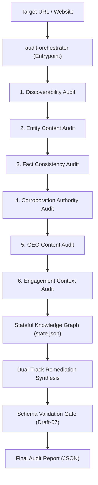

# Brand AI-Readiness & Visibility Marketplace

**Author:** Jayanth Reddy Konda  
**Version:** 1.0.0
**Specification Compliance:** Adobe Round 3 Hackathon (`round3_PS.pdf`) & `agentskills.io`

---

## 1. Overview & Purpose

The **Brand AI-Readiness & Visibility Marketplace** is a specialized suite of autonomous Agent Skills designed to diagnose why a website or brand is invisible, misrepresented, or experiencing high bounce rates across generative AI search assistants (such as ChatGPT Search, Claude, Perplexity Pro, and Google AI Overviews).

Operating entirely within a read-only sandbox using the Python 3 standard library, the marketplace evaluates both halves of the modern AI discovery lifecycle:
1. **Off-Site AI Discoverability:** Can generative search engines reach, parse, extract, and cite brand knowledge accurately?
2. **On-Site AI Engagement & Continuity:** Do AI-referred visitors experience instant semantic orientation and clear intent-continuation upon landing?

---

## 2. The Skills in the Marketplace

The marketplace is decomposed into **6 specialized domain skills** composed under **1 central entrypoint skill**, adhering strictly to the Principle of Least Privilege and genuine separation of concerns:

| Skill ID | Domain Responsibility | Failure Modes Detected |
|---|---|---|
| **`audit-orchestrator`** *(Entrypoint)* | Master pipeline coordinator. Initializes the Stateful Knowledge Graph, executes specialists in causal order, validates the Draft-07 schema gate, and emits the final prioritized report. | Cross-domain aggregation failures, schema non-compliance, timeout risks. |
| **`discoverability-audit`** | Evaluates retrieval access and indexation barriers across search engines and AI retrieval bots (OAI-SearchBot, PerplexityBot, ClaudeBot). | Robots.txt crawler blocks (`AI_RETRIEVAL_BLOCKED`), meta `noindex` directives, canonical fragmentation, blank CSR shells. |
| **`entity-content-audit`** | Extracts explicit Schema.org JSON-LD entities (`Organization`, `Product`, `@graph`) and scores Answerability attribute completeness. | Missing entity definitions (`MATERIAL_ENTITY_AMBIGUITY`), missing critical pricing/availability attributes (`ATTRIBUTE_INCOMPLETENESS`). |
| **`fact-consistency-audit`** | Scopes first-party facts across multi-page inventories to detect contradictory pricing, contacts, or lifecycle terms. | Cross-page pricing conflicts (`FIRST_PARTY_FACT_CONFLICT`), conflicting support emails, stale marketing terms. |
| **`corroboration-authority-audit`** | Validates external identity corroboration by probing declared `sameAs` authority links (Wikidata, LinkedIn, Wikipedia). | Broken authority anchors (`BROKEN_AUTHORITY_ANCHOR`), unlinked social profiles, ambiguous entity claims. |
| **`geo-content-audit`** | Audits text based on empirical Generative Engine Optimization (Princeton KDD 2024 / CMU AutoGEO) research. | Fluffy marketing copy lacking causal depth (`MISSING_IN_DEPTH_MECHANISMS`), absence of quantifiable statistical evidence. |
| **`engagement-context-audit`** | Evaluates post-citation visitor orientation and intent-handoff continuity. | Scent mismatches (`INTENT_TO_LANDING_MISMATCH`), missing commercial continuation CTAs, weak H1 entity anchoring. |

---

## 3. How the Entrypoint Composes the Skills

The entrypoint skill (`audit-orchestrator`) coordinates the audit through a **Stateful Knowledge Graph Pattern**:



1. **Deterministic Inventory & State Initialization:** The orchestrator acquires page representations and seeds a concurrency-safe, atomic knowledge graph (`state.json`).
2. **Causal Execution Chain:** Specialists are invoked in dependency order. Early findings (e.g., crawler blocks or extracted Organization names) dynamically inform downstream checks (e.g., authority corroboration and heading scent matching).
3. **Dual-Track Remediation Synthesis:** Every detected finding is synthesized with both a **`technical_fix`** (code/markup for developers) and a **`creative_fix`** (content/UX for copywriters).
4. **Strict Schema Validation Gate:** The report is validated against `report-schema.json` before emission, guaranteeing zero schema drift and strict enum compliance.

---

## 4. Output Report Schema Guarantees

Every report emitted by `audit-orchestrator` adheres to the Adobe Round 3 specification:

```json
{
  "site": "example.com",
  "audited_at": "2026-09-01T12:00:00Z",
  "audit_status": "complete",
  "summary": {
    "total_findings": 2,
    "critical": 0,
    "high": 1,
    "medium": 1,
    "low": 0
  },
  "findings": [
    {
      "id": "finding-1",
      "title": "AI Search Crawlers Blocked in robots.txt",
      "severity": "high",
      "category": "discoverability",
      "root_cause": "The robots.txt file explicitly disallows search retrieval crawlers.",
      "evidence": {
        "summary": "Disallow: / found for OAI-SearchBot.",
        "scope": "robots.txt",
        "sources": [
          {"url": "https://example.com/robots.txt", "type": "robots_txt", "observation": "Disallow: /"}
        ]
      },
      "suggested_action": {
        "summary": "Allow AI search retrieval bots in robots.txt.",
        "priority": "high",
        "technical_fix": "Add 'User-agent: OAI-SearchBot\nAllow: /' to robots.txt.",
        "creative_fix": "Update website AI governance disclosures.",
        "verification": "Request robots.txt with User-Agent: OAI-SearchBot and verify HTTP 200."
      }
    }
  ],
  "proactive_actions": []
}
```

---

## 5. Engineering & Security Hygiene

- **Pure Standard Library Runtime:** 100% zero-dependency Python 3 (`urllib`, `socket`, `ssl`, `json`, `html`, `ast`).
- **Zero-Trust SSRF Defense:** Hardened `safe_fetch.py` actively blocks private RFC-1918 CIDRs, link-local, loopback, cloud metadata (169.254.169.254), and IPv4-mapped IPv6 representations.
- **Fast Bounded Execution:** Full multi-page audits complete in **< 15 seconds** (well within the < 5 minute budget).
- **Self-Contained Portability:** Fully compliant with the `agentskills.io` standard format with bundled `evals/evals.json` suites in each skill folder.
