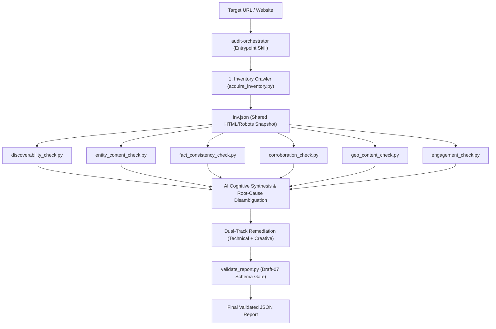

# Brand AI-Readiness & Visibility Marketplace

**Author:** Jayanth Reddy Konda  
**Version:** 2.1.0  
**Specification Compliance:** Adobe Round 3 Hackathon (`round3_PS.pdf`) & `agentskills.io`

---

## 1. Overview & Purpose

The **Brand AI-Readiness & Visibility Marketplace** is a specialized suite of autonomous Agent Skills designed to diagnose why a website or brand is invisible, misrepresented, or experiencing high bounce rates across generative AI search assistants (such as ChatGPT Search, Claude, Perplexity Pro, and Google AI Overviews).

Operating entirely within a read-only sandbox using the pure Python 3.9+ standard library (zero runtime pip dependencies), the marketplace evaluates both halves of the modern AI discovery lifecycle:
1. **Off-Site AI Discoverability:** Can generative search engines crawl, parse, extract, and cite brand knowledge accurately?
2. **On-Site AI Engagement & Continuity:** Do AI-referred visitors experience instant semantic orientation and clear intent-continuation upon landing?

---

## 2. The Skills in the Marketplace

The marketplace is decomposed into **6 specialized domain skills** composed under **1 central entrypoint skill**, adhering strictly to the Principle of Least Privilege and genuine separation of concerns:

| Skill ID | Domain Responsibility | Key Failure Modes & Signals Detected |
|---|---|---|
| **`audit-orchestrator`** *(Entrypoint)* | Master AI runbook coordinator. Directs the acquisition of site inventory, runs specialists in causal order, synthesizes cross-domain telemetry, and validates the final report against the Draft-07 schema gate. | Cross-domain multi-signal root causes, priority conflicts, schema non-compliance. |
| **`discoverability-audit`** | Evaluates retrieval access and indexation barriers across search engines and AI retrieval bots (OAI-SearchBot, PerplexityBot, Claude-SearchBot). | Robots.txt crawler blocks (`AI_RETRIEVAL_BLOCKED`), meta `noindex` exclusions, canonical fragmentation, blank CSR shells. |
| **`entity-content-audit`** | Extracts explicit Schema.org JSON-LD entities (`Organization`, `Product`, `@graph`) and scores Answerability attribute completeness. | Missing entity definitions (`MATERIAL_ENTITY_AMBIGUITY`), incomplete pricing/availability attributes (`ATTRIBUTE_INCOMPLETENESS`). |
| **`fact-consistency-audit`** | Scopes first-party facts across multi-page inventories with global multi-currency normalization to detect contradictory pricing, contacts, or lifecycle terms. | Cross-page pricing conflicts (`FIRST_PARTY_FACT_CONFLICT`), conflicting support emails, stale marketing terms. |
| **`corroboration-authority-audit`** | Validates external identity corroboration by probing declared `sameAs` authority links (Wikidata, LinkedIn, Wikipedia) with zero-trust SSRF sandboxing. | Broken authority anchors (`BROKEN_AUTHORITY_ANCHOR`), unlinked social profiles, ambiguous entity claims. |
| **`geo-content-audit`** | Audits text based on empirical Generative Engine Optimization (Princeton KDD 2024 / CMU AutoGEO) research across all 9 citability vectors. | Missing explanatory mechanisms (`MISSING_IN_DEPTH_MECHANISMS`), missing primary source citations, low statistical density, marketing fluff. |
| **`engagement-context-audit`** | Evaluates post-citation visitor orientation and intent-handoff continuity with OpenGraph metadata fallbacks. | Scent mismatches (`INTENT_TO_LANDING_MISMATCH`), missing commercial continuation CTAs, weak H1 entity anchoring. |

---

## 3. How the Entrypoint Composes the Skills

The entrypoint skill (`audit-orchestrator`) coordinates the audit through a **True Agentic Multi-Signal Reasoning Architecture**:



1. **Deterministic Inventory Acquisition:** The orchestrator runs `acquire_inventory.py` to acquire page representations, robots.txt, and sitemaps into `inv.json`.
2. **Independent Specialist Sensor Probing:** The AI Agent runs each of the 6 specialist tools via CLI against `inv.json`, collecting raw structured telemetry.
3. **Multi-Signal Cognitive Synthesis:** The AI Agent correlates findings across domains (e.g. connecting low word counts from discoverability, missing schema from entity-content, and missing H1 from engagement into a single SPA root cause).
4. **Dual-Track Remediation Synthesis:** Every detected finding is synthesized with both a **`technical_fix`** (code/markup for developers) and a **`creative_fix`** (content/UX for copywriters).
5. **Strict Schema Validation Gate:** The final JSON report is piped through `validate_report.py`, guaranteeing 100% compliance with Draft-07 JSON Schema before completion.

---

## 4. Output Report Schema Guarantees

Every report emitted by `audit-orchestrator` adheres strictly to the Adobe Round 3 specification:

```json
{
  "site": "https://example.com",
  "audited_at": "2026-09-02T12:00:00Z",
  "audit_status": "complete",
  "summary": {
    "total_findings": 2,
    "critical": 0,
    "high": 1,
    "medium": 1,
    "low": 0
  },
  "findings": [
    {
      "id": "finding-1",
      "title": "AI Search Crawlers Blocked in robots.txt",
      "severity": "high",
      "category": "discoverability",
      "root_cause": "The robots.txt file explicitly disallows search retrieval crawlers.",
      "evidence": {
        "summary": "Disallow: / found for OAI-SearchBot.",
        "scope": "robots.txt",
        "sources": [
          {"url": "https://example.com/robots.txt", "type": "robots_txt", "observation": "Disallow: /"}
        ]
      },
      "suggested_action": {
        "summary": "Allow AI search retrieval bots in robots.txt.",
        "priority": "high",
        "technical_fix": "Add 'User-agent: OAI-SearchBot\nAllow: /' to robots.txt.",
        "creative_fix": "Update website AI governance disclosures.",
        "verification": "Request robots.txt with User-Agent: OAI-SearchBot and verify HTTP 200."
      }
    }
  ],
  "proactive_actions": []
}
```

---

## 5. Quick Start & Execution Guide

```bash
# 1. Run the production QA pipeline (Ruff, Flake8, MyPy, Schema, Pytest)
./scripts/qa_check.sh

# 2. Acquire site inventory
python3 skills/audit-orchestrator/scripts/acquire_inventory.py \
  --site https://example.com --output inv.json --format json

# 3. Execute specialist sensors
python3 skills/discoverability-audit/scripts/discoverability_check.py --site https://example.com --inventory inv.json --format json
python3 skills/entity-content-audit/scripts/entity_content_check.py --site https://example.com --inventory inv.json --format json
python3 skills/fact-consistency-audit/scripts/fact_consistency_check.py --site https://example.com --inventory inv.json --format json
python3 skills/corroboration-authority-audit/scripts/corroboration_check.py --site https://example.com --inventory inv.json --format json
python3 skills/geo-content-audit/scripts/geo_content_check.py --site https://example.com --inventory inv.json --format json
python3 skills/engagement-context-audit/scripts/engagement_check.py --site https://example.com --inventory inv.json --format json

# 4. Validate output report against Draft-07 schema gate
python3 skills/audit-orchestrator/scripts/validate_report.py final_report.json
```

---

## 6. Verification & Quality Metrics

- **65 Automated Unit Tests:** 100% passing across 18 test modules in ~1.6 seconds.
- **Strict Linting & Style:** 0 errors under Ruff and Flake8 (`--max-line-length=140`).
- **Static Type Safety:** 0 errors under MyPy across all 7 skills.
- **SSRF Hardening:** Pure stdlib socket-level IP validation against RFC-1918, link-local, loopback, and IPv4-mapped IPv6 ranges.
