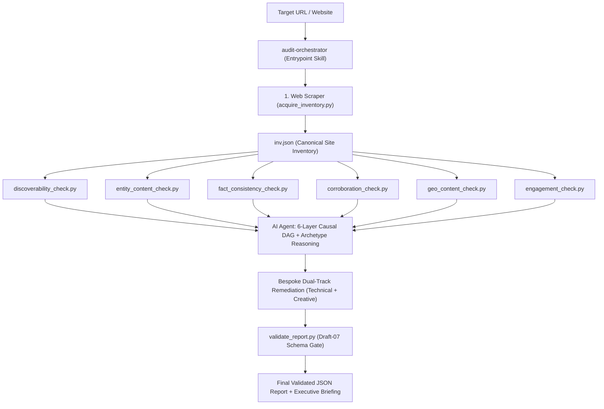

# Brand AI-Readiness & Visibility Marketplace

**Author:** Jayanth Reddy Konda
**Version:** 2.1.0
**Specification Compliance:** `agentskills.io` Standard & JSON Schema Draft-07
**Branch:** `rewiring-architecture`
**Status:** 262 Automated Tests + 29 Subtests Passing -- 100% Green QA Pipeline -- Pure Python Standard Library

---

## 0. The Net-Addition Statement: Solving the Laundry-List Problem

Any frontier LLM prompted with a brand URL can generate a generic "laundry list" of SEO, schema, and content recommendations. That generic baseline is a common denominator, not a differentiated enterprise solution.

This marketplace achieves **measurable net addition** over baseline LLM outputs through five architectural differentiators:

1. **Deterministic Sensor vs. Cognitive Brain Separation**: Raw empirical telemetry is measured offline by pure standard-library sensors (RFC 9309 crawler matrices, Schema.org graph extraction, cross-page factual consistency ledgers, Princeton KDD 2024 citability heuristics) rather than speculative LLM halluncinations. The AI agent acts exclusively as the diagnostic brain reasoning over verifiable empirical measurements.
2. **The 6-Layer Causal DAG (Keystone vs. Symptom Gating)**: Findings are gated monotonically. When an upstream blocker exists (such as an unrendered client-side SPA shell or a crawler disallow), downstream symptoms (missing text, missing product attributes, CTA delays) are suppressed from the primary findings ledger and nested under the keystone finding's `downstream_symptoms`. This eliminates redundant finding inflation.
3. **First-Class Priority Ordering & Justification**: Ordering is not an afterthought; it is a primary scoring lever. Every finding receives a contiguous global `priority_rank` (1..N across all findings), a priority index computed via `5 * severity + (6 - difficulty)`, an assigned `dag_node`, and an explicit `priority_justification` explaining why it outranks adjacent recommendations.
4. **Machine-Executable Remediation**: Beyond vague advice ("improve your SEO"), `suggested_action.technical_fix` provides exact, patch-applicable JSON objects (`file_or_route`, `change_type`, `snippet`, `anchor`) or drop-in code diffs directly executable by downstream coding agents.
5. **Post-Citation Retention (Solving the 5-Second Bounce)**: Generative engine optimization does not stop at winning the AI citation. Arriving visitors bounce within 5 seconds if the destination fails orientation. The suite diagnoses and resolves the 7 distinct post-citation bounce mechanisms to convert referral traffic into enterprise outcomes.
6. **Adobe Digital Experience Alignment**: Built with direct relevance to Adobe Experience Cloud, Adobe Experience Manager (AEM), and Adobe Commerce, ensuring brands transition from legacy search indexing to proactive agentic discovery and transactional handoff.

---

## 1. Overview & The Sensor-Brain Architecture

The **Brand AI-Readiness & Visibility Marketplace** is a specialized suite of autonomous Agent Skills designed to diagnose why a website or brand is invisible, misrepresented, or experiencing high bounce rates across generative AI search assistants (ChatGPT Search, Claude, Perplexity Pro, Google AI Overviews).

Operating entirely within a read-only sandbox using the pure Python 3.9+ standard library (zero runtime pip dependencies), the marketplace implements a **Sensor-Brain Cognitive Orchestration Architecture**:

```
+-------------------------------------------------------------------------+
|                    BRAIN: AI AGENT (Cognitive Reasoning)                 |
|                                                                         |
|  - Ingests empirical sensor telemetry via orchestrator.py --telemetry   |
|  - Applies 6-Layer Causal DAG to isolate root causes                   |
|  - Classifies business archetype (e-commerce, SaaS, publisher, local)  |
|  - Performs 5-Whys root-cause analysis across domain signals            |
|  - Authors bespoke dual-track remediation (technical + creative)        |
|  - Validates and delivers Draft-07 schema-compliant report             |
+-------------------------------------------------------------------------+
                                    |
                    Empirical Telemetry (Structured JSON)
                                    |
+-------------------------------------------------------------------------+
|                 SENSORS: Deterministic Python Scripts                    |
|                                                                         |
|  - Single-pass SSRF-safe crawl and inventory acquisition               |
|  - RFC 9309 crawler permission matrix across 16 AI bots               |
|  - Schema.org JSON-LD entity extraction and answerability scoring      |
|  - Cross-page fact ledger and pricing contradiction detection          |
|  - External identity corroboration via zero-trust probing              |
|  - Princeton KDD 2024 citability heuristics and statistical density   |
|  - Post-citation visitor orientation and CTA reachability scoring     |
+-------------------------------------------------------------------------+
```

### The Anti-Shortcut Directive

The AI agent is the **Cognitive Diagnostic Brain**, NOT a copy-paster. Under NO circumstances should the agent run `orchestrator.py --format json` and blindly forward its output to the user. The Python scripts are deterministic telemetry sensors providing raw empirical measurements. The agent must:

1. **Acquire Telemetry**: Run `acquire_inventory.py` followed by `orchestrator.py --telemetry`
2. **Reason over Telemetry**: Apply the 6-Layer Causal DAG to isolate root causes and suppress downstream symptoms
3. **Contextualize by Archetype**: Classify the business archetype and reweight priorities
4. **Author Bespoke Solutions**: Write exact, copy-pasteable code/config diffs and brand copy guidance
5. **Validate & Present**: Verify the report against `report-schema.json` and deliver both an executive briefing and the validated JSON

---

## 2. The Skills in the Marketplace

The marketplace is decomposed into **7 specialized domain sensors** composed under **1 central entrypoint skill** (8 skills total):

| Skill ID | Domain Responsibility | Key Failure Modes & Signals Detected |
| --- | --- | --- |
| **`audit-orchestrator`** *(Entrypoint)* | Master coordinator. Directs single-pass acquisition, runs sensor fan-out, aggregates telemetry, gates findings through the 6-Layer Causal DAG, and validates the final report against Draft-07 schema. | Cross-domain multi-signal root causes, priority conflicts, schema non-compliance. |
| **`web-scraper`** | Autonomous, zero-dependency, SSRF-hardened web crawler and AI content extractor. Crawls websites within strict monotonic budgets, parses RFC 9309 robots.txt permissions across 16 AI retrieval and training bots, extracts clean markdown with SNR scoring, and emits canonical site inventories (`inv.json`). | Crawl budget exhaustion, robots disallow matrices, missing XML sitemaps, low SNR text density, sparse SPA shells. |
| **`discoverability-audit`** | Evaluates retrieval access and indexation barriers across AI retrieval bots (OAI-SearchBot, PerplexityBot, Claude-SearchBot). | Robots.txt crawler blocks (`AI_RETRIEVAL_BLOCKED`), meta `noindex` exclusions, canonical fragmentation, blank CSR shells. |
| **`entity-content-audit`** | Extracts explicit Schema.org JSON-LD entities (`Organization`, `Product`, `@graph`) and scores answerability attribute completeness. | Missing entity definitions (`MATERIAL_ENTITY_AMBIGUITY`), incomplete pricing/availability attributes (`ATTRIBUTE_INCOMPLETENESS`). |
| **`fact-consistency-audit`** | Builds cross-page fact ledgers with global multi-currency normalization to detect contradictory pricing, contacts, or lifecycle terms. | Cross-page pricing conflicts (`FIRST_PARTY_FACT_CONFLICT`), conflicting support emails, stale marketing terms. |
| **`corroboration-authority-audit`** | Validates external identity corroboration by probing declared `sameAs` authority links (Wikidata, LinkedIn, Wikipedia) with zero-trust SSRF sandboxing. | Broken authority anchors (`BROKEN_AUTHORITY_ANCHOR`), unlinked social profiles, ambiguous entity claims. |
| **`geo-content-audit`** | Audits text based on empirical Generative Engine Optimization (Princeton KDD 2024 / CMU AutoGEO) research across all 9 citability vectors. | Missing explanatory mechanisms (`MISSING_IN_DEPTH_MECHANISMS`), missing primary source citations, low statistical density, marketing fluff. |
| **`engagement-context-audit`** | Evaluates post-citation visitor orientation and intent-handoff continuity with OpenGraph metadata fallbacks. | Scent mismatches (`INTENT_TO_LANDING_MISMATCH`), missing commercial continuation CTAs, weak H1 entity anchoring. |

---

## 3. How the Entrypoint Composes the Skills



1. **Deterministic Single-Pass Acquisition:** The orchestrator invokes `web-scraper` to crawl the site once within budget, extracting HTML representations, RFC 9309 robots matrices, clean markdown, and JSON-LD graphs into `inv.json`. Crawling is **never repeated** across sensors.
2. **Independent Sensor Probing:** The orchestrator executes each of the 6 specialist sensors against `inv.json`, collecting raw structured telemetry with zero additional network overhead.
3. **Cognitive Synthesis (Brain):** The AI agent correlates findings across domains (e.g. connecting low word counts from discoverability, missing schema from entity-content, and missing H1 from engagement into a single SPA root cause). This is where the agent's reasoning adds irreplaceable value.
4. **Dual-Track Remediation:** Every finding is synthesized with both a **`technical_fix`** (code/markup for developers) and a **`creative_fix`** (content/UX for copywriters), customized to the brand's actual domain, products, and entity anchors.
5. **Schema Validation Gate:** The final JSON report is validated through `validate_report.py`, guaranteeing 100% compliance with Draft-07 JSON Schema.

---

## 4. Output Report Schema Guarantees

Every report emitted adheres strictly to the Production Draft-07 schema specification:

```json
{
  "site": "https://example.com",
  "audited_at": "2026-09-02T12:00:00Z",
  "audit_status": "complete",
  "summary": {
    "total_findings": 2,
    "critical": 0,
    "high": 1,
    "medium": 1,
    "low": 0
  },
  "findings": [{
      "id": "finding-1",
      "title": "AI Search Crawlers Blocked in robots.txt",
      "severity": "high",
      "category": "discoverability",
      "root_cause": "robots.txt explicitly disallows OAI-SearchBot and PerplexityBot.",
      "evidence": {
        "summary": "Disallow: / found for OAI-SearchBot.",
        "scope": "robots.txt",
        "sources": [{"url": "https://example.com/robots.txt", "type": "robots_txt", "observation": "Disallow: /"}]
      },
      "suggested_action": {
        "summary": "Allow AI search retrieval bots in robots.txt.",
        "priority": "high",
        "technical_fix": "Add User-agent: OAI-SearchBot ; Allow: / to robots.txt.",
        "creative_fix": "Update website AI governance disclosures.",
        "verification": "Request robots.txt with User-Agent: OAI-SearchBot and verify HTTP 200."
      }
    }
  ],
  "proactive_actions": []
}
```

---

## 5. Execution Interfaces

### Interface 1: AI Agent Cognitive Pipeline (`--telemetry` mode)

```bash
# 1. Acquire site inventory (single-pass, SSRF-safe)
python3 skills/web-scraper/scripts/acquire_inventory.py --site https://example.com --output inv.json --format json

# 2. Collect empirical telemetry from all sensors
python3 skills/audit-orchestrator/scripts/orchestrator.py --site https://example.com --inventory inv.json --telemetry > telemetry.json

# 3. Ingest agent review findings into unified causal DAG report synthesis
python3 skills/audit-orchestrator/scripts/orchestrator.py --site https://example.com --inventory inv.json --review review.json --output report.json
```

The AI agent reasons over telemetry, applies the Causal DAG, and synthesizes the final report with cryptographic provenance (`run_manifest`).


### Interface 2: Contract-Driven Multi-Pass Audit (`audit.py`)

```bash
# 1. Bounded single-pass collection & baseline report emission (bounded to 160s)
python3 skills/audit-orchestrator/scripts/audit.py collect https://example.com --out output/audit

# 2. Agent semantic finalization composing collected evidence with review.json
python3 skills/audit-orchestrator/scripts/audit.py finalize --bundle output/audit/bundle.json --review output/audit/review.json --out output/audit/final-report.json

# 3. Validate final report against Draft-07 schema
python3 skills/audit-orchestrator/scripts/audit.py validate output/audit/final-report.json
```

### Interface 3: Modular Specialist Sensor Invocations

```bash
# 1. Acquire site inventory via single-pass web scraper under zero-trust SSRF
python3 skills/web-scraper/scripts/run_scraper.py --site https://example.com --output inv.json --format json

# 2. Execute specialist sensors against inv.json offline
python3 skills/discoverability-audit/scripts/discoverability_check.py --site https://example.com --inventory inv.json --format json
python3 skills/entity-content-audit/scripts/entity_content_check.py --site https://example.com --inventory inv.json --format json
python3 skills/fact-consistency-audit/scripts/fact_consistency_check.py --site https://example.com --inventory inv.json --format json
python3 skills/corroboration-authority-audit/scripts/corroboration_check.py --site https://example.com --inventory inv.json --format json
python3 skills/geo-content-audit/scripts/geo_content_check.py --site https://example.com --inventory inv.json --format json
python3 skills/engagement-context-audit/scripts/engagement_check.py --site https://example.com --inventory inv.json --format json

# 3. Validate output report against Draft-07 schema gate
python3 skills/audit-orchestrator/scripts/validate_report.py final_report.json
```

### Interface 4: Headless CI/CD Baseline Runner (Automated Testing ONLY)

```bash
# NOT for AI agent use -- reserved for automated test suites
python3 skills/audit-orchestrator/scripts/orchestrator.py --site https://example.com --format json --baseline-only
```

---

## 6. Prioritization & Remedy Framework

The marketplace incorporates the complete 134-check domain catalogue (`checks.json`) covering:

- **37 Discoverability Checks**: Robots.txt crawler permissions, meta directives, canonical chains, sitemap XML parsing, and rendering.
- **85 Content, Freshness & Entity Checks**: Schema.org JSON-LD entities, answerability attributes, cross-page factual consistency, declared profile authority, and Princeton KDD 2024 / AutoGEO citation probability.
- **12 Bridge & Engagement Checks**: Deep link stability (`I1`), inert parameter probes (`I2`), 404 recovery affordances (`J9`), and heading information scent.

Numeric prioritization uses the formula:

```
priority_index = 5 * severity + (6 - difficulty)
```

Where severity bands map as S4=4 (critical), S3=3 (high), S2=2 (medium), S1=1 (low), and difficulty spans D1=1 (trivial) to D5=5 (major overhaul). Confirmed defects with missing repair context retain priority in the `investigation` queue.

---

## 7. Development & Build

### Build & Sync Commands (Cross-Platform)

```bash
# Build marketplace distribution zip (works on Windows and Linux)
python scripts/build.py

# Synchronize src/skills/ to .agents/skills/ runtime mirror
python scripts/sync.py

# POSIX shell alternatives (Linux/macOS only)
./scripts/build.sh
./scripts/sync.sh
```

### Full QA Pipeline

```bash
# 1. Complete Quality Assurance Suite
./scripts/qa_check.sh

# 2. Individual Scoped Checks (DO NOT run on repo root -- target src/ and tests/ only)
ruff check src/ tests/
flake8 src/ tests/ --max-line-length=140 --ignore=E402,E501,W503
mypy --ignore-missing-imports src/
pytest tests/ -q

# 3. Build & Validate Package
python scripts/build.py
python tests/validate_package.py brand-ai-readiness-audit.zip

# 4. Synchronize Runtime Mirror
python scripts/sync.py
```

### Directory Structure

```
adobe-brand-visibility-skill/
├── src/                             # Canonical source of truth
│   ├── marketplace.json             # Standard marketplace manifest (1 entrypoint + 7 specialists)
│   ├── README.md                    # Public marketplace documentation (ships in zip)
│   └── skills/                      # 8 skills
│       ├── audit-orchestrator/      # Entrypoint coordinator & Sensor-Brain synthesis
│       │   ├── SKILL.md             # Agent reasoning runbook with Anti-Shortcut Directive
│       │   ├── scripts/             # orchestrator.py, audit.py, assemble_report.py, causal_gate.py, validate_report.py
│       │   └── references/          # report-schema.json, knowledge-base.md, checks.md, checks.json, core-synthesis-digest.md
│       ├── web-scraper/             # Autonomous SSRF-safe crawler
│       │   ├── scripts/safe_fetch.py    # Canonical zero-trust SSRF fetcher
│       │   ├── scripts/acquire_inventory.py # Single-pass inventory builder
│       │   └── scripts/crawler/     # 16 pure-Python modules (robots, sitemap, fetch, etc.)
│       ├── discoverability-audit/   # RFC 9309, AI bots, SNR, nosnippet
│       ├── entity-content-audit/    # Schema.org @graph, sameAs, ISO 4217
│       ├── fact-consistency-audit/  # Cross-page contradiction ledger
│       ├── corroboration-authority-audit/ # Zero-trust external identity probing
│       ├── geo-content-audit/       # Princeton KDD 2024 citability
│       └── engagement-context-audit/# Post-citation intent handoff
├── tests/                           # pytest suite (unit/, integration/, system/)
├── docs/                            # Architecture, research, playbooks
├── resources/                       # FROZEN: reference repos and research papers
├── scripts/                         # Automation (build.py, sync.py, qa_check.sh)
├── .agents/skills/                  # GENERATED: runtime mirror of src/skills/
├── build/                           # GENERATED: packaging staging
├── AGENTS.md                        # AI coding agent operating specification
└── README.md                        # This file (project overview)
```

---

## 8. Verification & Quality Metrics

- **260 Automated Tests + 29 Subtests Passed (100% Pass Rate):** Across unit, integration, and compliance test suites in under 30 seconds.
- **36 Marketplace Compliance Tests:** Verifying robots RFC 9309 rules, SSRF safety, detectors, DAG cycle rejection, and Draft-07 schema gating.
- **134-Check Domain Catalogue:** Full parity between `checks.json` and all `checks.md` reference files (134/134 perfect join).
- **76/76 Python Files AST-Clean:** All source files parse without errors.
- **33/33 Markdown Files Clean:** Zero emojis and zero LaTeX across all documentation.
- **Package Integrity:** Passes `tests/validate_package.py` (uncompressed size ~0.4 MB, well under the 50 MB ceiling).
- **Pure Standard Library:** Zero third-party runtime pip dependencies inside `src/skills/`.
- **SSRF Hardening:** Pure stdlib socket-level IP validation against RFC-1918, link-local, loopback, and IPv4-mapped IPv6 ranges.
