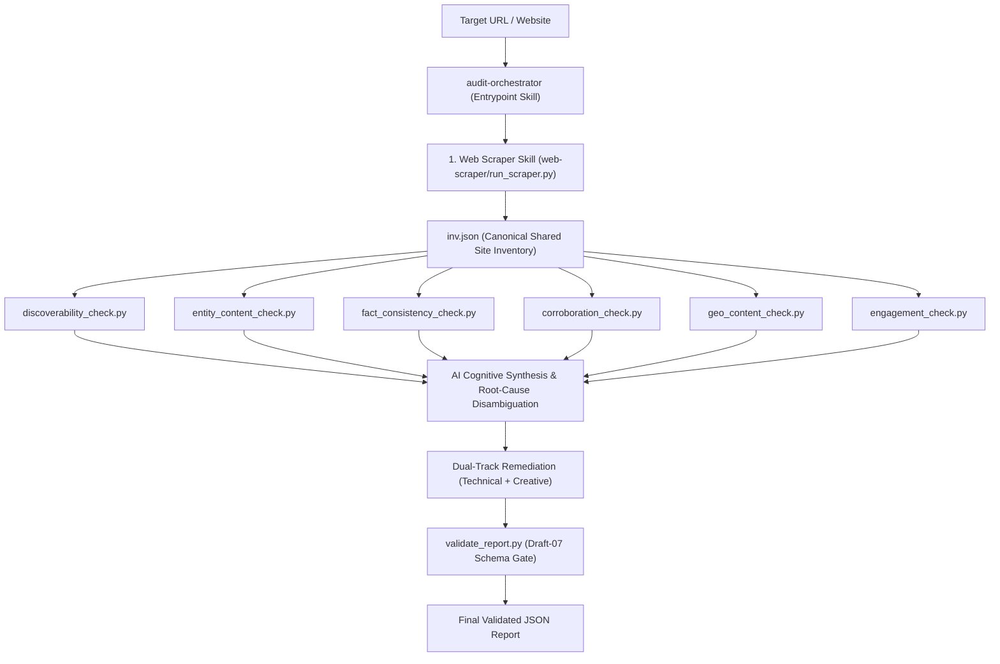

# Brand AI-Readiness & Visibility Marketplace

**Author:** Jayanth Reddy Konda  
**Specification Compliance:** `agentskills.io` Standard & JSON Schema Draft-07

---

## 1. Overview & Purpose

The **Brand AI-Readiness & Visibility Marketplace** is a specialized suite of autonomous Agent Skills designed to diagnose why a website or brand is invisible, misrepresented, or experiencing high bounce rates across generative AI search assistants (such as ChatGPT Search, Claude, Perplexity Pro, and Google AI Overviews).

Operating entirely within a read-only sandbox using the pure Python 3.9+ standard library (zero runtime pip dependencies), the marketplace evaluates both halves of the modern AI discovery lifecycle:
1. **Off-Site AI Discoverability:** Can generative search engines crawl, parse, extract, and cite brand knowledge accurately?
2. **On-Site AI Engagement & Continuity:** Do AI-referred visitors experience instant semantic orientation and clear intent-continuation upon landing?

---

## 2. The Skills in the Marketplace

The marketplace is decomposed into **7 specialized domain skills** composed under **1 central entrypoint skill** (8 skills total), adhering strictly to the Principle of Least Privilege and genuine separation of concerns:

| Skill ID | Domain Responsibility | Key Failure Modes & Signals Detected |
|---|---|---|
| **`audit-orchestrator`** *(Entrypoint)* | Master AI runbook coordinator. Directs the single-pass acquisition of site inventory, runs specialists in causal order, synthesizes cross-domain telemetry, and validates the final report against the Draft-07 schema gate. | Cross-domain multi-signal root causes, priority conflicts, schema non-compliance. |
| **`web-scraper`** | Autonomous, zero-dependency, SSRF-hardened web crawler and AI content extractor. Crawls websites within strict monotonic budgets, parses RFC 9309 robots.txt permissions across 16 AI retrieval & training bots, traverses XML sitemaps, flattens Schema.org JSON-LD graphs, extracts Trafilatura-grade clean Markdown with SNR scoring, scores commercial routes, and emits canonical site inventories (`inv.json`). | Crawl budget exhaustion, robots disallow matrices, missing XML sitemaps, low SNR text density, sparse SPA shells. |
| **`discoverability-audit`** | Evaluates retrieval access and indexation barriers across search engines and AI retrieval bots (OAI-SearchBot, PerplexityBot, Claude-SearchBot). | Robots.txt crawler blocks (`AI_RETRIEVAL_BLOCKED`), meta `noindex` exclusions, canonical fragmentation, blank CSR shells. |
| **`entity-content-audit`** | Extracts explicit Schema.org JSON-LD entities (`Organization`, `Product`, `@graph`) and scores Answerability attribute completeness. | Missing entity definitions (`MATERIAL_ENTITY_AMBIGUITY`), incomplete pricing/availability attributes (`ATTRIBUTE_INCOMPLETENESS`). |
| **`fact-consistency-audit`** | Scopes first-party facts across multi-page inventories with global multi-currency normalization to detect contradictory pricing, contacts, or lifecycle terms. | Cross-page pricing conflicts (`FIRST_PARTY_FACT_CONFLICT`), conflicting support emails, stale marketing terms. |
| **`corroboration-authority-audit`** | Validates external identity corroboration by probing declared `sameAs` authority links (Wikidata, LinkedIn, Wikipedia) with zero-trust SSRF sandboxing. | Broken authority anchors (`BROKEN_AUTHORITY_ANCHOR`), unlinked social profiles, ambiguous entity claims. |
| **`geo-content-audit`** | Audits text based on empirical Generative Engine Optimization (Princeton KDD 2024 / CMU AutoGEO) research across all 9 citability vectors. | Missing explanatory mechanisms (`MISSING_IN_DEPTH_MECHANISMS`), missing primary source citations, low statistical density, marketing fluff. |
| **`engagement-context-audit`** | Evaluates post-citation visitor orientation and intent-handoff continuity with OpenGraph metadata fallbacks. | Scent mismatches (`INTENT_TO_LANDING_MISMATCH`), missing commercial continuation CTAs, weak H1 entity anchoring. |

---

## 3. How the Entrypoint Composes the Skills

The entrypoint skill (`audit-orchestrator`) coordinates the audit through a **True Agentic Multi-Signal Reasoning Architecture** with a single-pass data acquisition model:



1. **Deterministic Single-Pass Acquisition:** The orchestrator invokes `web-scraper` to crawl the site once within budget, extracting HTML representations, RFC 9309 robots matrices, clean Markdown, and JSON-LD graphs into `inv.json`. Crawling is **never repeated** across specialists.
2. **Independent Specialist Sensor Probing:** The orchestrator executes each of the 6 specialist audit tools via CLI against `inv.json`, collecting raw structured telemetry with zero additional network overhead.
3. **Multi-Signal Cognitive Synthesis:** The cognitive engine correlates findings across domains (e.g. connecting low word counts from discoverability, missing schema from entity-content, and missing H1 from engagement into a single SPA root cause).
4. **Dual-Track Remediation Synthesis:** Every detected finding is synthesized with both a **`technical_fix`** (code/markup for developers) and a **`creative_fix`** (content/UX for copywriters).
5. **Strict Schema Validation Gate:** The final JSON report is piped through `validate_report.py`, guaranteeing 100% compliance with Draft-07 JSON Schema before completion.

---

## 4. Output Report Schema Guarantees

Every report emitted by `audit-orchestrator` adheres strictly to the Production Draft-07 schema specification:

```json
{
  "site": "https://example.com",
  "audited_at": "2026-09-02T12:00:00Z",
  "audit_status": "complete",
  "summary": {
    "total_findings": 2,
    "critical": 0,
    "high": 1,
    "medium": 1,
    "low": 0
  },
  "findings": [{
      "id": "finding-1",
      "title": "AI Search Crawlers Blocked in robots.txt",
      "severity": "high",
      "category": "discoverability",
      "root_cause": "The robots.txt file explicitly disallows search retrieval crawlers.",
      "evidence": {
        "summary": "Disallow: / found for OAI-SearchBot.",
        "scope": "robots.txt",
        "sources": [{"url": "https://example.com/robots.txt", "type": "robots_txt", "observation": "Disallow: /"}
        ]
      },
      "suggested_action": {
        "summary": "Allow AI search retrieval bots in robots.txt.",
        "priority": "high",
        "technical_fix": "Add 'User-agent: OAI-SearchBot ; Allow: /' to robots.txt.",
        "creative_fix": "Update website AI governance disclosures.",
        "verification": "Request robots.txt with User-Agent: OAI-SearchBot and verify HTTP 200."
      }
    }
  ],
  "proactive_actions": []
}
```

---

## 5. Execution Interfaces

### Interface 1: Autonomous Cognitive Pipeline (`orchestrator.py`)
```bash
# Execute full multi-skill audit with automatic single-pass crawl & Causal DAG synthesis
python3 skills/audit-orchestrator/scripts/orchestrator.py --site https://example.com --format json
```

### Interface 2: Contract-Driven Multi-Pass Audit (`audit.py`)
```bash
# 1. Bounded single-pass collection & baseline report emission (bounded to 160s)
python3 skills/audit-orchestrator/scripts/audit.py collect https://example.com --out output/audit

# 2. Agent semantic finalization composing collected evidence with review.json
python3 skills/audit-orchestrator/scripts/audit.py finalize --bundle output/audit/bundle.json --review output/audit/review.json --out output/audit/final-report.json

# 3. Validate final report against Draft-07 schema and consistency invariants
python3 skills/audit-orchestrator/scripts/audit.py validate output/audit/final-report.json
```

### Interface 3: Specialist Sensor Modular Invocations
```bash
# 1. Acquire site inventory via single-pass web scraper under zero-trust SSRF
python3 skills/web-scraper/scripts/run_scraper.py --site https://example.com --output inv.json --format json

# 2. Execute specialist sensors against inv.json offline
python3 skills/discoverability-audit/scripts/discoverability_check.py --site https://example.com --inventory inv.json --format json
python3 skills/entity-content-audit/scripts/entity_content_check.py --site https://example.com --inventory inv.json --format json
python3 skills/fact-consistency-audit/scripts/fact_consistency_check.py --site https://example.com --inventory inv.json --format json
python3 skills/corroboration-authority-audit/scripts/corroboration_check.py --site https://example.com --inventory inv.json --format json
python3 skills/geo-content-audit/scripts/geo_content_check.py --site https://example.com --inventory inv.json --format json
python3 skills/engagement-context-audit/scripts/engagement_check.py --site https://example.com --inventory inv.json --format json

# 3. Validate output report against Draft-07 schema gate
python3 skills/audit-orchestrator/scripts/validate_report.py final_report.json
```

---

## 6. Prioritization & Remedy Framework

The marketplace incorporates the complete 134-check domain catalogue (`checks.json`) covering:
- **37 Discoverability Checks**: Robots.txt crawler permissions, meta directives, canonical chains, sitemap XML parsing, and rendering.
- **85 Content, Freshness & Entity Checks**: Schema.org JSON-LD entities, Answerability attributes, cross-page factual consistency, declared profile authority, and Princeton KDD 2024 / AutoGEO citation probability.
- **12 Bridge & Engagement Checks**: Deep link stability (`I1`), inert parameter probes (`I2`), 404 recovery affordances (`J9`), and heading information scent.

Numeric prioritization uses the formula:
```
priority_index = 5 * severity + (6 - difficulty)
```
Where severity bands map as S4=4 (critical), S3=3 (high), S2=2 (medium), S1=1 (low), and difficulty spans D1=1 (trivial) to D5=5 (major overhaul). Confirmed defects with missing repair context retain priority in the `investigation` queue.

---

## 7. Verification & Quality Metrics

- **315 Automated Tests Passed (100% Pass Rate):** Across unit, integration, and compliance test suites in under 45 seconds.
- **36 Marketplace Compliance Tests:** Verifying robots RFC 9309 rules, SSRF safety, detectors, DAG cycle rejection, and Draft-07 schema gating.
- **Strict Linting & Style:** 0 errors under Ruff and Flake8 (`--max-line-length=140`).
- **Static Type Safety:** 0 errors under MyPy across all 8 skills.
- **Package Integrity:** Passes `tests/validate_package.py` on source and distribution zip (uncompressed size ~2.3 MB, well under the 50 MB ceiling).
- **Pure Standard Library:** Zero third-party runtime pip dependencies inside `src/skills/`.
- **SSRF Hardening:** Pure stdlib socket-level IP validation against RFC-1918, link-local, loopback, and IPv4-mapped IPv6 ranges.
