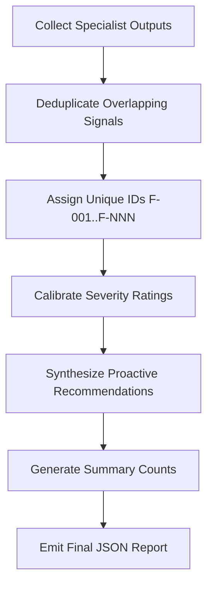

# Composition, Reconciliation & Severity Guidelines

This guide details how `audit-orchestrator` composes specialist audit outputs, resolves conflicts, deduplicates overlapping signals, calculates severity levels, and synthesizes proactive improvements.

---

## 1. Specialist Skill Responsibilities

1. **`crawl-render-audit`**: Focuses strictly on technical access, bot directives, DOM hydration/render barriers, text vs non-text barriers, and JSON-LD schema presence.
2. **`freshness-corroboration`**: Focuses on fact decay, date markers, cross-page claim divergence, and entity disambiguation (`sameAs` links).
3. **`engagement-audit`**: Focuses on visitor orientation, heading hierarchies (`H1-H3`), navigational integrity, and concise AI summary extractability.

---

## 2. Reconciliation & Deduplication Workflow

When specialist skills return individual findings, the orchestrator performs the following normalization:

### Overlap Deduplication Rules
- **Schema & Entity Conflict**: If `crawl-render-audit` reports missing `Organization` schema and `freshness-corroboration` reports missing `sameAs` links, consolidate into a single finding prioritizing structured entity markup with `sameAs` identifiers.
- **Render Gaps & Heading Extraction**: If `crawl-render-audit` notes client-side-only rendering and `engagement-audit` reports missing `H1` tags due to JS-only rendering, merge into an SSR / DOM accessibility finding with specific engagement impacts cited in evidence.

---

## 3. Severity & Priority Rubric

| Level | Discoverability Criteria | Engagement Criteria | Action Priority |
| :--- | :--- | :--- | :--- |
| **`critical`** | Site completely blocked to AI indexers (`robots.txt` disallows all bots, HTTP 403/500, empty HTML body). | Severe site malfunction, broken primary conversion funnel, unreadable layout. | Immediate fix required |
| **`high`** | No structured data (JSON-LD missing), core brand facts locked in images/canvas without text equivalents, major entity ambiguity. | Missing above-the-fold value prop, absent `H1` tag, broken primary navigation. | Urgent (P1) |
| **`medium`** | Stale dates (>2 years old), missing `dateModified`, minor schema omissions (e.g. missing `BreadcrumbList`). | Confusing heading hierarchy, excessive jargon/filler text diluting AI summary quality. | Recommended (P2) |
| **`low`** | Proactive enhancements (e.g. adding `llms.txt`, FAQ schemas where none exist). | Minor styling or micro-copy improvements. | Proactive (P3) |

---

## 4. Proactive Suggestions (Beyond Direct Defects)

A high-scoring audit report does not stop at flagging explicit errors; it recommends proactive architectural optimizations that give brands an AI visibility edge:

1. **`llms.txt` & `llms-full.txt` Endpoint**: Provide standard Markdown documentation indexes for LLM web readers.
2. **Entity Disambiguation via Wikidata & Knowledge Graph**: Link official identities in JSON-LD `sameAs` to prevent brand name collisions.
3. **Structured FAQPage & Q&A Schema**: Expose key user questions directly in machine-readable format for conversational answer extraction.
4. **Summary-First Information Design**: Position high-density 1-2 sentence core value propositions at the top of landing pages for instant assistant parsing.

