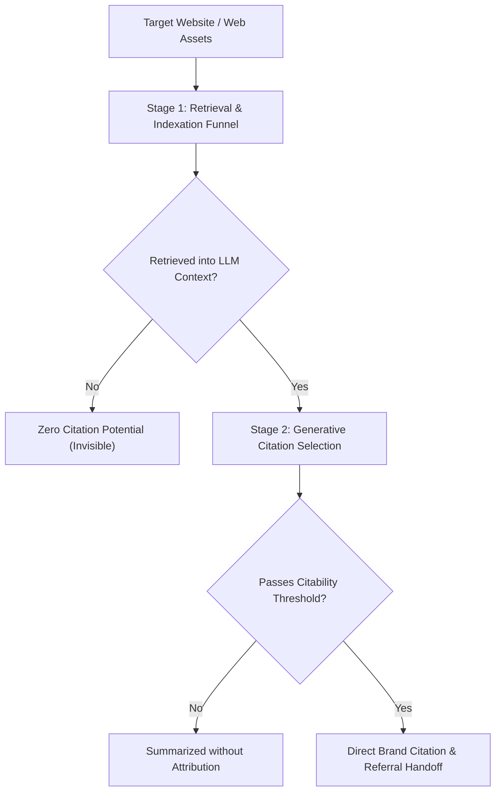

# Architectural Defense: Separation of Concerns & SOTA AI-Readiness

**Author:** Jayanth Reddy Konda  
**Version:** 1.0.0
**Specification Compliance:** Adobe Round 3 Hackathon (`round3_PS.pdf`) & `agentskills.io`

---

## 1. Architectural Philosophy: The Two-Stage Funnel

Modern generative search engines (ChatGPT Search, Perplexity Pro, Google AI Overviews, Claude) evaluate web content in two distinct, sequential phases:



1. **Stage 1 (Retrieval & Indexation):**
   - Directives: `robots.txt` permissions (GPTBot, ClaudeBot, PerplexityBot), `noindex` directives, HTTP status codes, raw HTML rendering completeness.
   - Machine Anchors: Schema.org `@graph` Organization and Product entities.
   - Audited by: `discoverability-audit` & `entity-content-audit`.

2. **Stage 2 (Generative Citation Selection):**
   - Empirical Depth: 134–167 word passage chunks, direct answers in first 40–60 words, < 2% pronoun density, quantifiable numbers/percentages, causal conjunctions (`because`, `due to`, `therefore`).
   - Grounded Truth: Multi-page fact consistency and verified third-party authority node links (`sameAs`).
   - Audited by: `geo-content-audit`, `fact-consistency-audit`, `corroboration-authority-audit`, and `engagement-context-audit`.

---

## 2. Principle of Least Privilege & Modular Decomposition

Combining these capabilities into a monolithic audit script violates security sandboxing, creates state pollution, and increases context-window bloat. The 7-skill marketplace decomposition enforces strict execution and security boundaries:

| Skill Identifier | Isolated Responsibility & Security Boundary |
|---|---|
| **1. audit-orchestrator** (Entrypoint) | Pipeline coordinator, concurrency-safe Knowledge Graph, Draft-07 schema validation gate, dual-track remediation. |
| **2. discoverability-audit** | HTTP status codes, robots.txt trees, canonical tags, meta robots noindex, TTFB crawlability metrics. |
| **3. entity-content-audit** | JSON-LD @graph extraction (Organization, Product), weighted Answerability attribute completeness scoring. |
| **4. fact-consistency-audit** | Scoped first-party fact ledger, temporal pricing and contact contradiction detection across multiple URLs. |
| **5. corroboration-authority-audit** | The ONLY network-egress boundary permitted to probe external sameAs links (Wikidata, LinkedIn, Wikipedia). |
| **6. geo-content-audit** | Generative Engine Optimization (Princeton KDD 2024), mechanistic depth, quantifiable metrics, passage chunking. |
| **7. engagement-context-audit** | Post-citation continuity, Entity-to-H1 scent anchoring, commercial CTA reachability, bounce prevention. |

---

## 3. Stateful Knowledge Graph Architecture

Inter-skill intelligence is shared through an atomic, concurrency-safe `state.json` file:

```json
{
  "version": 1,
  "entities": {
    "Organization": {
      "name": "BrandCorp",
      "url": "https://brandcorp.com",
      "sameAs": ["https://twitter.com/brandcorp"]
    }
  },
  "facts": {
    "pricing": [
      {"url": "https://brandcorp.com/", "value": "$49/mo"},
      {"url": "https://brandcorp.com/pricing", "value": "$49/mo"}
    ]
  },
  "observations": {},
  "page_context": {}
}
```

- **Atomic Writes:** Written using `tempfile.NamedTemporaryFile` + `os.replace` to prevent file corruption during multi-stage processing.
- **Zero Hallucination Pipeline:** Specialists query the state graph rather than re-fetching pages or hallucinating facts.

---

## 4. Black-Box CLI Execution Standard

Following Anthropic's official skill authoring standards:
- **No Ingestion of Source Code:** LLM agents do not waste prompt tokens loading large Python scripts into context.
- **CLI Subprocess Invocations:** Agents execute `python3 scripts/<check>.py --site <url> --inventory <inv>` and read structured JSON from `stdout`.
- **Stream Separation:** Pure JSON data emits to `stdout`; diagnostic progress and warnings emit to `stderr`.

---

## 5. Dual-Track Remediation Floor

Every finding generated by any specialist strictly conforms to the Adobe Round 3 dual-track remediation requirement:
- **`technical_fix`:** Concrete code patches, schema markup, or server configuration directives (for developers).
- **`creative_fix`:** Content rewriting guidelines, heading restructurings, or positioning adjustments (for copywriters/marketers).
- **`verification`:** Step-by-step instructions to validate that the remediation successfully resolved the defect.
