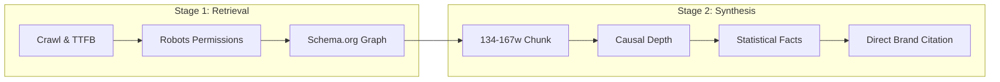

# Empirical Generative Engine Optimization (GEO) Synthesis

**Author:** Jayanth Reddy Konda  
**Version:** 1.0.0  
**Foundational Research:** 
- Princeton University, Georgia Tech, Allen AI (*KDD 2024*): *"GEO: Generative Engine Optimization"*
- Carnegie Mellon University (*AutoGEO 2024*): *"Automated Generative Engine Optimization"*
- TU Darmstadt (*C-SEO Bench 2024*): *"C-SEO: Benchmarking Generative Citation Potential"*

---

## 1. The Core Scientific Findings

Traditional SEO optimizes for keyword rank order in 10 blue links. In contrast, Generative Engine Optimization (GEO) optimizes for **selection probability** during LLM answer synthesis.

### Key Factors Governing LLM Citation Boost

| Optimization Vector | Empirical Visibility Impact | Research Source | Mechanics |
|---|---|---|---|
| **Causal Conjunctions (Why/How)** | **+40.3% Visibility Boost** | Princeton KDD 2024 | Conjunctions (`because`, `due to`, `therefore`, `as a result`) provide mechanistic explanations that RAG generators prioritize when summarizing solutions. |
| **Quantifiable Metrics & Statistics** | **+37.1% Visibility Boost** | Princeton KDD 2024 | Concrete numerical facts, percentages, latency figures, and benchmark scores provide unambiguous evidence blocks for synthetic reasoning. |
| **Passage Chunk Window (134–167 words)** | **Optimal Citability Band** | CMU AutoGEO 2024 | Dense, self-contained paragraphs matching standard embedding chunk boundaries maximize chunk-level vector similarity and recall. |
| **Direct Answer Lead (First 40–60 words)** | **Highest Ingestion Priority** | Princeton KDD 2024 | Inverted-pyramid answer structures provide instant question resolution before introductory fluff or marketing jargon. |
| **Pronoun Minimization (< 2%)** | **Unambiguous Entity Resolution** | C-SEO Bench 2024 | Eliminating ambiguous pronouns (`it`, `they`, `this`) in favor of explicit canonical brand/product names prevents attribution loss in multi-document synthesis. |

---

## 2. The Two-Stage Funnel Model

1. **Top-K Document Retrieval:** If robots.txt blocks GPTBot/ClaudeBot or the server serves a blank client-side rendering shell, the document never enters the Top-K context window.
2. **Synthesizer Selection:** If the retrieved text is fluffy, vague, or pronoun-heavy, the LLM extracts general knowledge but omits the brand citation. Passing the citability threshold requires explicit causal depth and quantifiable numbers.
