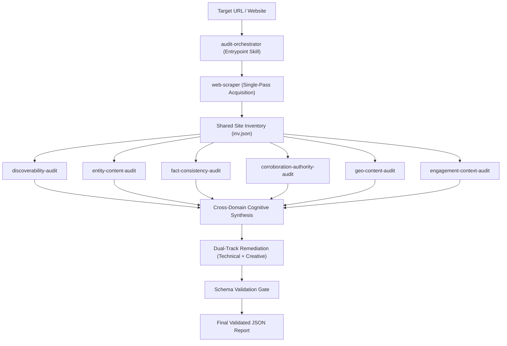

# Brand AI-Readiness & Visibility Marketplace

**Author:** Jayanth Reddy Konda  
**Specification Compliance:** `agentskills.io` Standard & JSON Schema Draft-07

---

## 1. Overview & Purpose

The **Brand AI-Readiness & Visibility Marketplace** is an autonomous suite of Agent Skills designed to diagnose why a website or brand is invisible, misquoted, or experiencing high bounce rates across generative AI search assistants—including **ChatGPT Search, Claude, Perplexity Pro, and Google AI Overviews**.

It evaluates both halves of the modern AI discovery lifecycle:
1. **Off-Site AI Discoverability:** Can generative search engines crawl, parse, extract, and cite brand knowledge accurately?
2. **On-Site AI Engagement & Continuity:** Do AI-referred visitors experience instant semantic orientation and clear intent-continuation upon landing?

The marketplace requires zero external runtime dependencies (pure Python 3.9+ standard library) and operates entirely read-only within a secure agent sandbox.

---

## 2. How to Run (Prompt Examples)

To run an audit, invoke the AI Agent using natural language prompts. The marketplace's entrypoint skill (`audit-orchestrator`) automatically activates, acquires the target site inventory in a single pass, coordinates specialist domain skills, and emits a Draft-07 schema-validated report.

### Quick Audit
> *"Audit example.com"*

> *"Audit https://example.com and check its AI search readiness."*

### Full AI Citation & GEO Diagnosis
> *"Run a comprehensive AI readiness audit on https://brand.com to diagnose why we aren't being cited in ChatGPT Search and Perplexity."*

> *"Analyze our website for Generative Engine Optimization (GEO), schema completeness, and AI search crawler access."*

### Targeted Diagnostic Prompts
> *"Check if our robots.txt or meta tags are blocking AI search engines on example.com."*

> *"Audit https://example.com for pricing consistency, entity authority, and visitor landing page orientation from AI search referrals."*

---

## 3. The Skills in the Marketplace

The marketplace decomposes AI brand visibility into **7 specialized domain skills** composed under **1 central entrypoint skill** (8 skills total), adhering strictly to the Principle of Least Privilege:

| Skill ID | Domain Responsibility | Key Failure Modes & Signals Detected |
|---|---|---|
| **`audit-orchestrator`** *(Entrypoint)* | Master Coordinator | Directs the single-pass acquisition of site inventory, runs specialists in causal order, synthesizes cross-domain telemetry, and validates the final report against the Draft-07 schema gate. |
| **`web-scraper`** | Crawler & Extractor | Crawls websites within strict budgets, inspects RFC 9309 robots.txt permissions across 16 AI retrieval & training bots, extracts clean markdown, and flattens Schema.org JSON-LD graphs into a shared inventory. |
| **`discoverability-audit`** | Search Engine Retrieval | Evaluates retrieval access and indexation barriers across search engines and AI retrieval bots (OAI-SearchBot, PerplexityBot, Claude-SearchBot), detecting crawler blocks, meta `noindex` exclusions, and blank CSR shells. |
| **`entity-content-audit`** | Entity Identity & Schema | Extracts explicit Schema.org JSON-LD entities (`Organization`, `Product`, `@graph`) and audits Answerability attribute completeness. |
| **`fact-consistency-audit`** | Factual Integrity & Drift | Scans across pages to detect contradictory pricing, conflicting support contacts, or stale lifecycle marketing terms. |
| **`corroboration-authority-audit`** | Identity Corroboration | Probes declared `sameAs` authority links (Wikidata, LinkedIn, Wikipedia) to verify external third-party identity substantiation. |
| **`geo-content-audit`** | Citation Probability (GEO) | Audits content based on empirical Generative Engine Optimization (Princeton KDD 2024 / CMU AutoGEO) research across all 9 citability vectors (direct answer leads, technical depth, evidence density). |
| **`engagement-context-audit`** | Post-Citation Continuity | Evaluates above-the-fold clarity, heading scent, CTA visibility, and intent-handoff friction for visitors arriving from AI search summaries. |

---

## 4. How the Entrypoint Composes the Skills

The entrypoint skill (`audit-orchestrator`) coordinates the audit through a clean, single-pass pipeline:



1. **Deterministic Single-Pass Acquisition:** The orchestrator invokes `web-scraper` to crawl the site once, extracting HTML representations, robots rules, clean Markdown, and JSON-LD graphs into a shared inventory (`inv.json`). Crawling is never repeated.
2. **Specialist Sensor Probing:** Each specialist skill audits the shared inventory offline across its specific domain with zero redundant network overhead.
3. **Multi-Signal Cognitive Synthesis:** The cognitive engine correlates findings across domains (e.g., connecting low word counts from discoverability, missing schema from entity-content, and missing H1 from engagement into an underlying Client-Side Rendering root cause).
4. **Dual-Track Remediation:** Every detected finding is synthesized with both a **`technical_fix`** (code/markup for developers) and a **`creative_fix`** (content/UX for copywriters).
5. **Schema Gate:** The final JSON report is verified against the Draft-07 specification before completion.

---

## 5. Output Report Format

The entrypoint emits a clear, structured JSON audit report adhering to Draft-07 schema specifications:

```json
{
  "site": "https://example.com",
  "audited_at": "2026-09-08T12:00:00Z",
  "audit_status": "complete",
  "summary": {
    "total_findings": 2,
    "critical": 0,
    "high": 1,
    "medium": 1,
    "low": 0
  },
  "findings": [
    {
      "id": "finding-1",
      "title": "AI Search Crawlers Blocked in robots.txt",
      "severity": "high",
      "category": "discoverability",
      "root_cause": "The robots.txt file explicitly disallows search retrieval crawlers.",
      "evidence": {
        "summary": "Disallow: / found for OAI-SearchBot and PerplexityBot.",
        "scope": "robots.txt",
        "sources": [
          {
            "url": "https://example.com/robots.txt",
            "type": "robots_txt",
            "observation": "Disallow: /"
          }
        ]
      },
      "suggested_action": {
        "summary": "Allow AI search retrieval bots in robots.txt.",
        "priority": "high",
        "technical_fix": "Add 'User-agent: OAI-SearchBot\\nAllow: /' to robots.txt.",
        "creative_fix": "Update website AI governance disclosures to clarify search crawling permissions.",
        "verification": "Request robots.txt with User-Agent: OAI-SearchBot and verify HTTP 200."
      }
    }
  ],
  "proactive_actions": [
    {
      "id": "proactive-1",
      "title": "Publish Curated /llms.txt Directory",
      "summary": "Provide a machine-readable llms.txt index of key brand facts and product documentation for LLMs.",
      "priority": "medium"
    }
  ]
}
```
